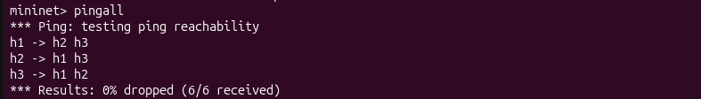
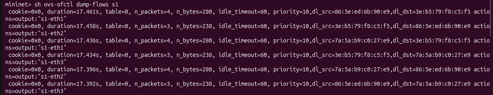
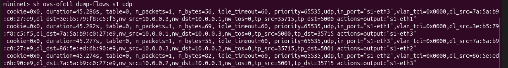
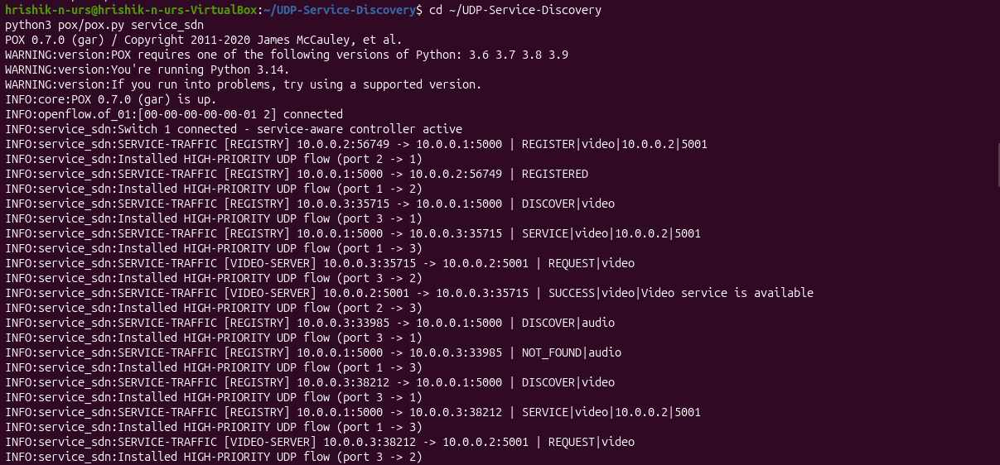
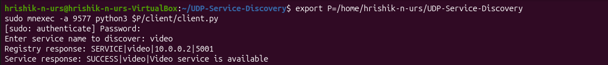
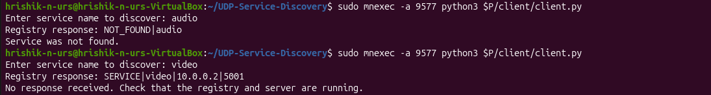

# UDP-Based Service Discovery System with Mininet and SDN (POX)

A service discovery system built on raw UDP sockets and run over a software-defined network. A server registers a service with a registry, and a client asks the registry where the service lives and then contacts that server directly. The network is emulated in Mininet and controlled by a custom POX (OpenFlow) controller that recognises the application traffic and installs flow rules for it.

## Objectives

- Implement service registration and discovery using low-level UDP sockets (`SOCK_DGRAM`), with no hardcoded server address in the client.
- Emulate a network with Mininet: one Open vSwitch and three hosts.
- Control the network with a custom POX controller (`service_sdn`).
- Show the socket application and the SDN network working together: application traffic on the service ports triggers controller behaviour and flow rules in the switch.
- Test normal and failure cases: service found, service not found, server down.

## Architecture

```
            +------------------+
            |  POX controller  |   (service_sdn, remote, port 6633)
            +--------+---------+
                     | OpenFlow
              +------+-------+
              |  s1 (OVS)    |
              +--+----+----+-+
                 |    |    |
        +--------+  +-+--+  +--------+
        |  h1      | h2   |  h3      |
        | Registry | Server| Client  |
        | 10.0.0.1 |10.0.0.2|10.0.0.3|
        | UDP 5000 | UDP 5001|        |
        +----------+-------+---------+
```

| Component | Host | Role |
|---|---|---|
| Registry | h1 (10.0.0.1), UDP 5000 | Maps service names to IP and port |
| Server | h2 (10.0.0.2), UDP 5001 | Provides the video service |
| Client | h3 (10.0.0.3) | Discovers the service, then requests it |
| Controller | POX, `service_sdn` | Learns hosts, recognises service traffic, installs flows |

### Communication flow

1. **REGISTER**: the server registers `video` with the registry; the registry replies `REGISTERED`.
2. **DISCOVER**: the client asks the registry for `video`.
3. **SERVICE**: the registry replies `SERVICE|video|10.0.0.2|5001`.
4. **REQUEST**: the client sends a request directly to the server at that address.
5. **SUCCESS**: the server replies `SUCCESS|video|Video service is available`.

If the service is unknown, the registry replies `NOT_FOUND|<name>`. Malformed messages get `INVALID_REQUEST`.

### Error handling

The client uses a 3-second socket timeout, so a lost packet or a dead server produces `No response received.` instead of hanging.

### SDN behaviour

- The controller learns hosts and installs generic Layer 2 forwarding flows (priority 10).
- It recognises traffic on UDP ports 5000 and 5001, logs the application messages (DISCOVER, SERVICE, REQUEST, SUCCESS) and installs specific exact-match high-priority flows for that traffic.
- Application events in the socket layer therefore trigger behaviour in the network layer.

## Project structure

```
.
├── registry/       UDP registry (registry.py)
├── server/         UDP video service server (server.py)
├── client/         UDP client (client.py)
├── controller/     POX controller component (service_sdn.py)
├── tests/          Helper scripts (register.py)
├── docs/
│   └── screenshots/  Result screenshots
└── README.md
```

## Requirements

- Linux (developed on Ubuntu in VirtualBox)
- Python 3
- Mininet and Open vSwitch
- POX (not included in this repository, see below)

## How to run

**1. Get POX and install the controller.** POX is a separate project, so clone it next to this code and copy the controller in:

```
git clone https://github.com/noxrepo/pox
cp controller/service_sdn.py pox/ext/
```

**2. Reset anything left over from earlier runs:**

```
pkill -f pox.py
sudo pkill -f registry.py
sudo pkill -f server.py
sudo mn -c
```

**3. Terminal 1: start the controller:**

```
python3 pox/pox.py service_sdn
```

**4. Terminal 2: start Mininet:**

```
sudo mn --topo single,3 --controller remote
```

At the `mininet>` prompt, run `dump` and note the pid of h1, h2 and h3, then run `pingall` (expect 0% dropped).

**5. Terminal 3: registry inside h1** (use the real pid from `dump`):

```
sudo mnexec -a H1PID python3 registry/registry.py
```

**6. Terminal 4: server inside h2:**

```
sudo mnexec -a H2PID python3 server/server.py
```

**7. In the Mininet prompt, register the service from h2:**

```
h2 python3 /full/path/to/UDP-Service-Discovery/tests/register.py
```

**8. Terminal 5: client inside h3:**

```
sudo mnexec -a H3PID python3 client/client.py
```

Enter `video` when prompted.

**9. Inspect the flow rules in the Mininet prompt:**

```
sh ovs-ofctl dump-flows s1
sh ovs-ofctl dump-flows s1 udp
```

Replace `H1PID`, `H2PID` and `H3PID` with the numbers from `dump`. They change on every run.

## Test cases

| Test | Input | Expected result |
|---|---|---|
| Service found | `video` | `SERVICE\|video\|10.0.0.2\|5001`, then `SUCCESS\|video\|Video service is available` |
| Service not found | `audio` | `NOT_FOUND\|audio`, then `Service was not found.` |
| Server down | stop the server, then `video` | `SERVICE\|video...`, then after 3 s `No response received.` |
| Recovery | restart the server, then `video` | `SUCCESS` again |

## Screenshots

Add images to `docs/screenshots/` and link them here.









## Team contributions

| Member | Contributions |
|---|---|
| Jayanth T D| Architecture & Socket Implementation: Designed the system architecture, built the raw UDP client, registry, and server scripts, and implemented the application-level messaging and error handling. |
| Hrishik N Urs | Mininet & SDN Implementation: Designed the virtual Mininet topology, configured the remote POX controller, and verified host-to-switch connectivity and generic L2 flow rules. |
| Jeevan M | Socket-SDN Integration & Testing: Integrated the application components across Mininet hosts, executed end-to-end tests (service found, service not found, server down), and verified dynamic UDP flow rule installation|

## Limitations and future work (Deliverable 2)

- The controller currently installs service-specific forwarding rules and logs service events. Dynamic behaviour such as blocking, rerouting or load balancing is planned.
- The registry does not yet remove a server that stops responding. Server health checking and de-registration are planned.
- The registry handles one datagram at a time in a loop, so multiple clients are served one after another rather than concurrently.
