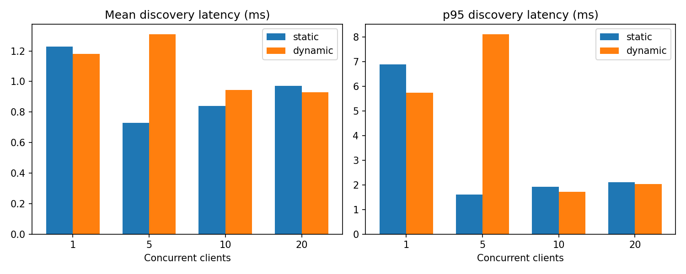
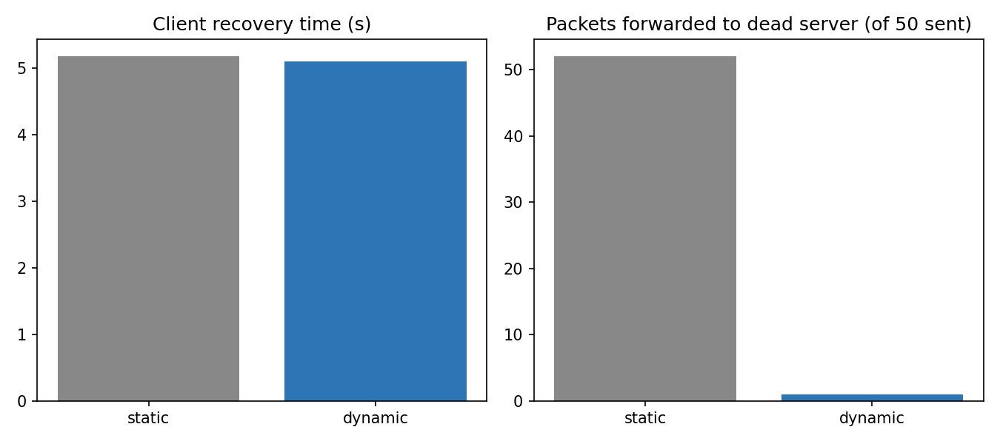

# UDP-Based Service Discovery System with Mininet and SDN (POX)

A service discovery system built on raw UDP sockets and run over a software-defined network. Servers advertise a service, a registry keeps track of which servers are alive, and a client asks the registry where the service lives and then contacts that server directly. The network is emulated in Mininet and controlled by a custom POX (OpenFlow) controller that recognises the application traffic, installs flow rules for it and reacts when a server fails.

## Objectives

- Implement service advertisement, registration and discovery using low-level UDP sockets (`SOCK_DGRAM`), with no hardcoded server address in the client.
- Maintain a service registry, handle timeouts and detect unavailable servers.
- Emulate a network with Mininet: one Open vSwitch and several hosts.
- Control the network with a custom POX controller.
- Show the socket application and the SDN network working together: application events trigger controller behaviour and flow rules in the switch.
- Measure discovery latency and compare a dynamic controller with a static baseline.

## Contents

- [Deliverable 1: basic system](#deliverable-1-basic-system)
- [Deliverable 2: dynamic service discovery with SDN reaction](#deliverable-2-dynamic-service-discovery-with-sdn-reaction)
- [Project structure](#project-structure)
- [Requirements](#requirements)
- [Team contributions](#team-contributions)

---

# Deliverable 1: basic system

## Architecture

```
            +------------------+
            |  POX controller  |   (service_sdn, remote, port 6633)
            +--------+---------+
                     | OpenFlow
              +------+-------+
              |  s1 (OVS)    |
              +--+----+----+-+
                 |    |    |
         +-------+  +-+--+ +--------+
         |   h1     |  h2  |   h3   |
         | Registry |Server| Client |
         | 10.0.0.1 |10.0.0.2|10.0.0.3|
         | UDP 5000 |UDP 5001|       |
         +----------+------+--------+
```

| Component | Host | Role |
|---|---|---|
| Registry | h1 (10.0.0.1), UDP 5000 | Maps service names to IP and port |
| Server | h2 (10.0.0.2), UDP 5001 | Provides the video service |
| Client | h3 (10.0.0.3) | Discovers the service, then requests it |
| Controller | POX, `service_sdn` | Learns hosts, recognises service traffic, installs flows |

### Communication flow

1. **REGISTER**: the server registers `video` with the registry; the registry replies `REGISTERED`.
2. **DISCOVER**: the client asks the registry for `video`.
3. **SERVICE**: the registry replies `SERVICE|video|10.0.0.2|5001`.
4. **REQUEST**: the client sends a request directly to the server at that address.
5. **SUCCESS**: the server replies `SUCCESS|video|Video service is available`.

If the service is unknown, the registry replies `NOT_FOUND|<name>`. Malformed messages get `INVALID_REQUEST`.

### Error handling

The client uses a 3-second socket timeout, so a lost packet or a dead server produces `No response received.` instead of hanging.

### SDN behaviour (D1)

- The controller learns hosts and installs generic Layer 2 forwarding flows (priority 10).
- It recognises traffic on UDP ports 5000 and 5001, logs the application messages (DISCOVER, SERVICE, REQUEST, SUCCESS) and installs specific exact-match flows for that traffic.

## How to run D1

**1. Get POX and install the controller.** POX is a separate project, so clone it next to this code and copy the controller in:

```
git clone https://github.com/noxrepo/pox
cp controller/service_sdn.py pox/ext/
```

**2. Reset anything left over from earlier runs:**

```
pkill -f pox.py
sudo pkill -f registry.py
sudo pkill -f server.py
sudo mn -c
```

**3. Terminal 1: start the controller:**

```
python3 pox/pox.py service_sdn
```

**4. Terminal 2: start Mininet:**

```
sudo mn --topo single,3 --controller remote
```

At the `mininet>` prompt, run `dump` and note the pid of h1, h2 and h3, then run `pingall` (expect 0% dropped).

**5. Terminal 3: registry inside h1** (use the real pid from `dump`):

```
sudo mnexec -a H1PID python3 registry/registry.py
```

**6. Terminal 4: server inside h2:**

```
sudo mnexec -a H2PID python3 server/server.py
```

**7. In the Mininet prompt, register the service from h2:**

```
h2 python3 /full/path/to/UDP-Service-Discovery/tests/register.py
```

**8. Terminal 5: client inside h3:**

```
sudo mnexec -a H3PID python3 client/client.py
```

Enter `video` when prompted.

**9. Inspect the flow rules at the Mininet prompt:**

```
sh ovs-ofctl dump-flows s1
sh ovs-ofctl dump-flows s1 udp
```

Replace `H1PID`, `H2PID` and `H3PID` with the numbers from `dump`. They change on every run.

## D1 test cases

| Test | Input | Expected result |
|---|---|---|
| Service found | `video` | `SERVICE\|video\|10.0.0.2\|5001`, then `SUCCESS\|video\|Video service is available` |
| Service not found | `audio` | `NOT_FOUND\|audio`, then `Service was not found.` |
| Server down | stop the server, then `video` | `SERVICE\|video...`, then after 3 s `No response received.` |
| Recovery | restart the server, then `video` | `SUCCESS` again |

## D1 screenshots

pingall result (0 percent dropped):


Generic flow rules installed by the controller:


Client: service found:


UDP flow rules for the service traffic:


POX controller log:


Client: not found and timeout:


---

# Deliverable 2: dynamic service discovery with SDN reaction

## What is new in D2

- Servers advertise themselves: a heartbeat message every 3 seconds, so no manual registration is needed.
- The registry removes a server that has been silent for 9 seconds and reports `REGISTERED` and `EXPIRED` events.
- A service can have several servers (primary and backup). The registry returns the first live one.
- The client measures discovery latency, retries and rediscovers when a server does not respond.
- The POX controller (`service_sdn_v2`) reads the registry events and changes the switch: it blocks a dead server and unblocks it when it returns.
- Performance scripts compare the dynamic controller with the static D1 controller.

## D2 architecture

```
        POX controller (service_sdn_v2)
          |  OpenFlow        reads /tmp/registry_events.log
          |
        s1 (Open vSwitch)
     +------+------+------+
     |      |      |      |
    h1     h2     h3     h4
 Registry Primary Backup Client
 10.0.0.1 10.0.0.2 10.0.0.3 10.0.0.4
 UDP 5000 UDP 5001 UDP 5002
```

Topology script: `topology/topology.py` (equivalent to `sudo mn --topo single,4 --controller remote`).

## Message formats

```
ADVERTISE|name|port             server to registry, sent every 3 s (no reply)
REGISTER|name|ip|port           manual registration, reply REGISTERED
DISCOVER|name                   client to registry
SERVICE|name|ip|port            registry reply when found
NOT_FOUND|name                  registry reply when unknown
INVALID_REQUEST                 registry reply to a malformed message
REQUEST|name                    client to server
SUCCESS|name|served by port N   server reply
```

Registry events written to `/tmp/registry_events.log`:

```
REGISTERED|name|ip|port
EXPIRED|name|ip|port
```

## How the SDN reaction works

1. The registry writes an `EXPIRED` event when a server stops advertising for 9 seconds.
2. The controller polls the event file every second.
3. On `EXPIRED` it deletes the dead server's flows and installs a priority 300 DROP rule for that server's IP and UDP port.
4. On `REGISTERED` for a blocked server it removes the DROP rule (recovery).
5. All other service traffic keeps being logged and forwarded with exact-match priority flows.

This is blocking and recovery. It is not rerouting: the switch drops traffic to the dead server, and the application (client and registry) moves to the backup.

## How to run D2

**1. Reset and start the controller (Terminal 1):**

```
sudo service openvswitch-switch start
pkill -f pox.py
sudo pkill -f registry
sudo pkill -f server
sudo mn -c
sudo rm -f /tmp/registry_events.log
cp controller/service_sdn_v2.py pox/ext/
python3 pox/pox.py service_sdn_v2
```

**2. Start the network (Terminal 2):**

```
sudo python3 topology/topology.py
```

At the `mininet>` prompt run `pingall` (expect 0% dropped) and `dump` (note the four pids).

**3. In separate terminals, replace H1PID to H4PID with the numbers shown by `dump`.** Start the primary first and wait a few seconds before starting the backup:

```
export P=/path/to/UDP-Service-Discovery
sudo mnexec -a H1PID python3 $P/registry/registry_v2.py
sudo mnexec -a H2PID python3 $P/server/server_v2.py 10.0.0.1 video 5001
sudo mnexec -a H3PID python3 $P/server/server_v2.py 10.0.0.1 video 5002
sudo mnexec -a H4PID python3 $P/client/client_v2.py 10.0.0.1 video
```

**4. Inspect the switch at the `mininet>` prompt:**

```
sh ovs-ofctl dump-flows s1 udp
sh ovs-ofctl dump-ports s1 2
```

## Test scenario: service failure

1. Start the registry, the primary (port 5001) and then the backup (port 5002).
2. Run the client: it is given the primary and gets `SUCCESS`.
3. Stop the primary with Ctrl+C.
4. Run the client again: it first tries the dead primary, times out, rediscovers and is given the backup (`SUCCESS` from port 5002).
5. After 9 seconds the registry prints `EXPIRED`, and the POX log shows `SDN REACTION` with the DROP rule. The rule appears in `dump-flows` as priority 300 with `actions=drop`.
6. Restart the primary: the POX log shows the DROP rule removed, and the flow disappears.

All test cases are listed in `tests/TEST_CASES.md`.

## Measurement scripts

```
tests/measure.py       discovery latency with N concurrent clients, appends to results/latency.csv
tests/probe.py         sends N requests straight to a dead server address
tests/make_report.py   builds the charts and tables in results/
```

Examples:

```
sudo mnexec -a H4PID python3 $P/tests/measure.py 10.0.0.1 video 10 20 dynamic
sudo mnexec -a H4PID python3 $P/tests/probe.py 10.0.0.2 5001 50
python3 tests/make_report.py
```

## Results

The baseline is the D1 controller (`service_sdn`), which forwards traffic but never reacts to a server failure. Every run used 20 requests per client, and no request was lost.

Mean discovery latency (ms):

| Clients | Static baseline | Dynamic controller |
|---|---|---|
| 1 | 1.23 | 1.18 |
| 5 | 0.73 | 1.31 |
| 10 | 0.84 | 0.93 |
| 20 | 0.97 | 0.93 |

Failure behaviour (primary server stopped):

| Metric | Static baseline | Dynamic controller |
|---|---|---|
| Client recovery time (until SUCCESS from the backup) | 5.18 s | 5.10 s |
| Packets forwarded to the dead server port during a 50-packet probe | 52 | 1 |





Raw data: `results/latency.csv` and `results/failure_comparison.csv`.

What the results show:

- Discovery latency is about the same under both controllers (about 1 ms), because both forward discovery traffic in the same way.
- Client recovery time is the same, because it is set by the registry timeout (9 seconds) and the client retries, not by the controller.
- The measurable benefit of the dynamic controller is that traffic to a dead server is dropped at the switch: 1 packet reached the dead server port instead of 52 (the 1 is background traffic such as ARP).

## Limitations and future work

- The controller blocks and unblocks servers. It does not reroute traffic, balance load or prioritise flows.
- The registry returns the first live server for a service, so there is no load balancing between primary and backup.
- The registry handles one datagram at a time in a loop, so concurrent clients are served one after another. It was measured with up to 20 concurrent clients and no loss.
- The registry and the controller exchange events through a file in `/tmp`, which works because both run on the same VM. A real deployment would use a network channel.
- Recovery time is dominated by the 9 second expiry. A shorter timeout would recover faster but risks false expiry when heartbeats are lost.
- Measurements are short runs in an emulated network. Differences of a few tenths of a millisecond are noise.
- The demo UI (`ui/gui.py`) was built for the D1 files and is not updated for the v2 files.

---

## Project structure

```
.
+-- registry/       registry.py (D1), registry_v2.py (D2)
+-- server/         server.py (D1), server_v2.py (D2)
+-- client/         client.py (D1), client_v2.py (D2)
+-- controller/     service_sdn.py (D1), service_sdn_v2.py (D2)
+-- topology/       topology.py (Mininet topology, 1 switch and 4 hosts)
+-- tests/          register.py, measure.py, probe.py, make_report.py, TEST_CASES.md
+-- results/        latency.csv, failure_comparison.csv, charts
+-- ui/             gui.py (D1 demo UI)
+-- docs/
|   +-- screenshots/  result screenshots
+-- README.md
```

## Requirements

- Linux (developed on Ubuntu in VirtualBox)
- Python 3
- Mininet and Open vSwitch
- POX (not included in this repository, see How to run D1)
- matplotlib, only for `tests/make_report.py`

## Team contributions

### Deliverable 1

| Member | Contributions |
|---|---|
| Jayanth T D | Architecture and socket implementation: designed the system architecture, built the raw UDP client, registry and server scripts, and implemented the application-level messaging and error handling. |
| Hrishik N Urs | Mininet and SDN implementation: designed the virtual Mininet topology, configured the remote POX controller, and verified host-to-switch connectivity and generic L2 flow rules. |
| Jeevan M | Socket-SDN integration and testing: integrated the application components across Mininet hosts, executed end-to-end tests (service found, service not found, server down), and verified dynamic UDP flow rule installation. |

### Deliverable 2

| Member | Contributions |
|---|---|
| Jayanth T D | Upgraded the application: `registry_v2.py` (heartbeat expiry, events, multiple servers per service), `server_v2.py`, `client_v2.py` (latency measurement, retries and rediscovery). |
| Hrishik N Urs | SDN reaction: `service_sdn_v2.py` (reads registry events, DROP rule when a server expires, unblocks on recovery), topology script, service failure scenario. |
| Jeevan M | Performance evaluation: `measure.py`, `probe.py`, `make_report.py`, static versus dynamic comparison, results and charts. |
